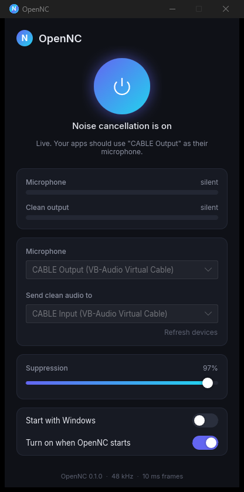

<p align="center"></p>

<h1 align="center">OpenNC</h1>

<p align="center">Open-source, real-time noise cancellation for your microphone.<br>
Press one button; every app hears a clean voice.</p>

<p align="center"></p>

OpenNC takes your microphone, removes background noise with the open [OpenNC model](https://github.com/MAkcanca/OpenNC)
(trained from scratch on open data, 48 kHz, 10 ms frames) and sends the clean voice into a virtual microphone that Discord,
Zoom, Teams, OBS or any other app can use. One small native program, no account, no cloud, nothing leaves your machine.

## Install (Windows)

1. Download `OpenNC-<version>-Setup.exe` from [Releases](../../releases/latest) and run it. It installs per user, no admin
   prompt, and can start with Windows.
2. Install [VB-Cable](https://vb-audio.com/Cable/) (free) if you do not have a virtual cable. OpenNC detects it and offers
   the download on first run.
3. Open OpenNC, choose your microphone, keep "CABLE Input" as the output, press the power button.
4. In your apps, choose "CABLE Output" as the microphone.

OpenNC lives in the system tray. Closing the window keeps it running; the tray icon toggles noise cancellation and quits.
Updates are offered inside the app and verified against the release checksums before they are installed.

The download is not code-signed yet, so Windows SmartScreen may warn on first launch: choose "More info", then "Run anyway".
Signing through [SignPath Foundation](https://signpath.org) is planned.

macOS and Linux: the engine and the app build on both ([BlackHole](https://existential.audio/blackhole/) or a PipeWire null
sink as the cable), but there are no packaged builds yet.

## How it works

- **Model:** a DeepFilterNet3-family network, 8.2 M parameters, 48 kHz, no lookahead, trained on DNS Challenge 4 speech and
  noise with cleaned targets. Weights, training pipeline and benchmarks: [MAkcanca/OpenNC](https://github.com/MAkcanca/OpenNC).
- **Engine:** the per-frame ONNX graph runs on one CPU thread in about 1 ms per 10 ms of audio (`src/engine.rs`,
  validated against the reference implementation to 3e-5).
- **Audio:** one thread owns the microphone and the output at 48 kHz with 10 ms buffers; latency from microphone to cable
  is about 50 ms (`src/audio.rs`). If a device disappears, OpenNC waits and resumes when it is back.
- **Footprint, measured** (Ryzen 7 7700, release build, 10 s samples): 14 % of one core while noise cancellation is on
  (engine 8.5 %, the rest is audio I/O and meters), 0 % when off, 150 MB of memory off and 185 MB on, no GPU use. Window
  open or hidden in the tray makes no difference.
- **App:** Rust, [Slint](https://slint.dev) for the interface, [cpal](https://github.com/RustAudio/cpal) for audio,
  [ort](https://ort.pyke.io) for onnxruntime. Settings in `%APPDATA%\OpenNC\config.json`, log in `opennc.log` next to it.

## Build

```
cargo build --release            # target/release/opennc (GUI) and opennc-cli
cargo test --release             # engine must match the Python reference on tests/data (needs models/opennc-v1)
opennc-cli devices               # list audio devices as the app names them
opennc-cli live <model_dir> "<mic>" "<output>" 10     # run the loop for 10 s and report dropped buffers
opennc-cli <model_dir> in.wav out.wav                  # offline processing, 48 kHz wav
```

Rust 1.85+. The model goes in `models/opennc-v1` (unzip `opennc-v1-stream.zip` from the OpenNC release). The installer is
built with Inno Setup: `ISCC /DAppVersion=x.y.z installer/opennc.iss`. Tagging `vx.y.z` builds and publishes a release
through GitHub Actions.

## License

Apache License 2.0. Model weights: Apache 2.0, see the OpenNC repository. Inter font: SIL Open Font License.
